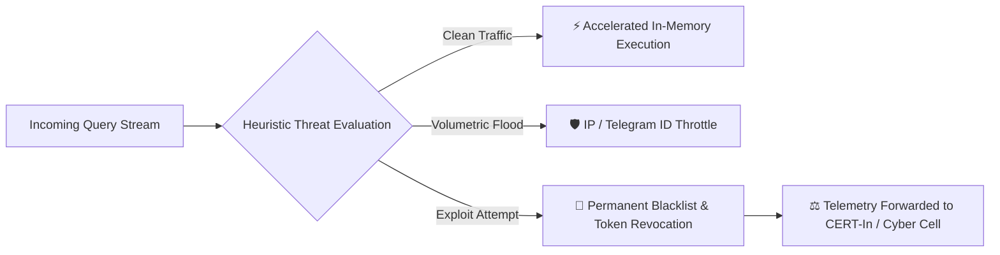

# 
🚫 ACCEPTABLE USE POLICY & ANTI-ABUSE DIRECTIVE

  

[-00FF66?style=for-the-badge&logo=telegram&logoColor=black)](./ACCEPTABLE_USE_POLICY.md#5-reporting-abuse)

---

[Home](./README.md) • [Terms of Service](./TERMS_OF_SERVICE.md) • [Privacy Policy](./PRIVACY_POLICY.md) • [Legal Disclaimer](./LEGAL_DISCLAIMER.md) • [Telecom Compliance](./COMPLIANCE_AND_TELECOM.md) • [Security & IP](./SECURITY_AND_IP.md)

---

 

> [!CAUTION]
> **ZERO TOLERANCE FOR ILLEGAL HARASSMENT, SPAM & SYSTEM EXPLOITATION:**  
> Any attempt to use Fresh NumChecker for automated robocalls, unsolicited telemarketing, SIM-swap attacks, credential stuffing, scraping, or unauthorized exploitation will result in immediate permanent banning, forfeiture of credits, and referral to cybercrime authorities under the **Information Technology Act, 2000**.

---

## ⚡ Permitted vs. Prohibited Usage Matrix

| Category | ✅ Permitted & Lawful Use | ❌ Strictly Prohibited Violations |
| :--- | :--- | :--- |
| **Data Hygiene** | Verifying user-opted database lists for syntax validity. | Checking stolen, leaked, or scraped phone lists. |
| **Telecom Audits** | Validating National Numbering Plan (NNP) series compliance. | Telemarketing without checking DND / TRAI registry. |
| **Security Research** | Defensive testing of internal organizational telecom flows. | Reconnaissance for SIM-swapping, OSINT harassment, or ATO. |
| **System Access** | Interacting via official Telegram Bot commands and UI buttons. | Reverse-engineering backend protocols or sniffing private APIs. |
| **Traffic Patterns** | Normal single and batch requests within established rate limits. | DDoS flooding, rotating proxies, or flood attacks. |

---

## 🔄 Threat Detection & Enforcement Pipeline

---

## 📑 Table of Contents

1. [Purpose & Applicability](#1-purpose-and-applicability)
2. [Strictly Prohibited Activities](#2-strictly-prohibited-activities)
   - [2.1 Unlawful Communications & Telemarketing](#21-unlawful-communications--telemarketing-violations)
   - [2.2 Cybercrime, Fraud & Identity Attacks](#22-cybercrime-fraud--identity-compromise)
   - [2.3 System Abuse & Attack Vectors](#23-system-abuse-network-interference--attack-vectors)
   - [2.4 Intellectual Property Piracy](#24-intellectual-property-theft--commercial-piracy)
3. [Usage Quotas & Rate Limiting Controls](#3-usage-quotas-and-rate-limiting)
4. [Investigation, Enforcement & Remedies](#4-investigation-enforcement--remedies)
5. [Abuse Reporting Desk](#5-reporting-abuse)

---

## 1. PURPOSE AND APPLICABILITY
This Acceptable Use Policy ("AUP") defines the mandatory rules and behavioral boundaries governing all interactions with the **Fresh NumChecker** ecosystem, including its public repositories, Telegram bot interfaces, private gateways, and communication channels. 

Violation of any provision in this AUP constitutes a material breach of the Master Terms of Service and will trigger immediate punitive technical and legal enforcement without warning or refund.

---

## 2. STRICTLY PROHIBITED ACTIVITIES

You are strictly prohibited from utilizing the Platform, directly or through automated scripts, for any of the following:

### 2.1. Unlawful Communications & Telemarketing Violations
- Generating, facilitating, or sending Unsolicited Commercial Communications (UCC), spam SMS messages, bulk WhatsApp promotional campaigns, or automated robocalls to numbers flagged or verified by the system;
- Circumventing the **National Do Not Call (NDNC) Registry** or **TRAI TCCCPR 2018** regulations;
- Contacting consumers without their explicit, auditable, and verifiable opt-in consent.

### 2.2. Cybercrime, Fraud & Identity Compromise
- Conducting unauthorized reconnaissance, OSINT targeting, cyber-stalking, or harassment against any individual, public figure, or private citizen;
- Validating leaked databases, stolen credit card records, credential-stuffing dumps, or dark-web subscriber lists;
- Attempting account takeovers (ATO), social engineering fraud, SIM-swap targeting, or banking verification bypasses;
- Operating phishing campaigns, malicious link distribution, or deceptive prize/lottery scams.

### 2.3. System Abuse, Network Interference & Attack Vectors
- Launching Denial of Service (DoS), Distributed Denial of Service (DDoS), or volumetric flood attacks against Fresh NumChecker infrastructure;
- Attempting to exploit software bugs, race conditions, buffer overflows, or injection vulnerabilities;
- Bypassing or attempting to bypass rate limits, CAPTCHA mechanisms, or token authentication controls;
- Using rotating residential proxies or TOR exit nodes to conceal malicious volumetric abuse;
- Rapid multi-threading beyond established API thresholds or server safety limits.

### 2.4. Intellectual Property Theft & Commercial Piracy
- Decompiling, disassembling, or sniffing backend network traffic to replicate the zero-OTP verification logic;
- Scraping, crawling, or extracting the proprietary National Numbering Plan database tables or circle resolution matrices;
- Creating clone bots, repackaging the service under a different name, or reselling unauthorized access without explicit written enterprise licensing;
- Removing or altering copyright watermarks, legal disclaimers, or promotional headers.

---

## 3. USAGE QUOTAS AND RATE LIMITING
To preserve system equilibrium and ensure 99.99% availability for all legitimate users:
- **Single Checks:** Rate-limited to standard human interaction intervals (minimum 1.5 seconds between individual single checks);
- **Batch Processing:** Allowed strictly through designated `/batch` multi-line channels with automated backoff;
- **Concurrent Requests:** Automated flood detection will temporarily freeze any account that submits excessive bursts within microsecond intervals.

Attempting to distribute queries across disposable fake Telegram accounts to circumvent rate limits will trigger automated permanent subnet blacklisting.

---

## 4. INVESTIGATION, ENFORCEMENT & REMEDIES
4.1. **Automated Threat Detection.** The Platform incorporates machine-learning heuristics, entropy analysis, and intrusion detection systems (IDS) that continuously monitor incoming traffic for abuse patterns.  
4.2. **Disciplinary Actions.** Upon detecting any violation of this AUP, the Operators reserve the right to immediately take any or all of the following actions at their sole discretion:
- Immediate revocation of access tokens and termination of the user's Telegram session;
- Permanent IP address, CIDR subnet, and Telegram ID blacklisting;
- Forfeiture of all remaining account credits, wallet balances, or subscription access without refund;
- Reporting of criminal conduct, malicious exploits, or severe abuse to law enforcement authorities (including the Indian Computer Emergency Response Team - CERT-In, National Cyber Crime Reporting Portal, and state police cyber cells).

---

## 5. REPORTING ABUSE
If you suspect or discover that our platform is being utilized by any bad actor for unlawful purposes, please report it immediately to our compliance desk:

- **Incident Reporting:** Open a support ticket via the Telegram Bot dashboard (`/help` -> Report Abuse Ticket).
- **Required Details:** Include relevant phone numbers, timestamps, logs, and evidence of unauthorized activity.

 

<a href="#top">⬆ Back to Top</a>

  

**© 2026 Fresh NumChecker Inc. All Rights Reserved.**  
*Strict Anti-Spam & Defensive Telecom Governance.*

