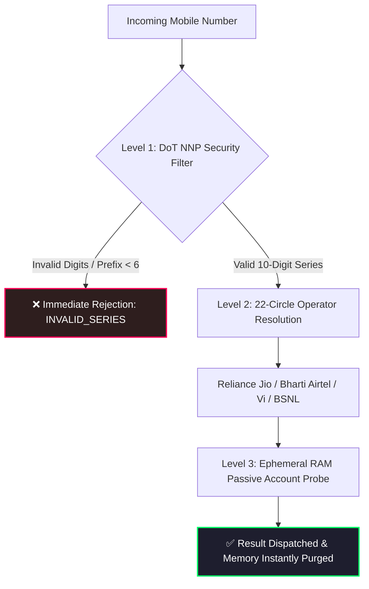

# 
📡 TELECOMMUNICATIONS & STATUTORY REGULATORY DIRECTIVE

[-FF9933?style=for-the-badge&logo=target&logoColor=white)](https://trai.gov.in)
[-7928CA?style=for-the-badge&logo=fastapi&logoColor=white)](https://dot.gov.in)

---

[Home](./README.md) • [Terms of Service](./TERMS_OF_SERVICE.md) • [Privacy Policy](./PRIVACY_POLICY.md) • [Legal Disclaimer](./LEGAL_DISCLAIMER.md) • [Acceptable Use](./ACCEPTABLE_USE_POLICY.md) • [Security & IP](./SECURITY_AND_IP.md)

---

 

> [!NOTE]
> **TELECOM REGULATORY POSITIONING:**  
> Fresh NumChecker operates strictly as an application-layer data hygiene, syntax evaluation, and defensive verification utility. It does not operate telecommunications network equipment, does not transmit commercial electronic communications, and does not provide public telecommunications services.

---

## ⚡ Regulatory Compliance Matrix (At a Glance)

| Governing Body / Statute | Key Legal Mandate | Fresh NumChecker Compliance Implementation |
| :--- | :--- | :--- |
| **Department of Telecommunications (DoT)** | National Numbering Plan (NNP) enforcement. | Algorithmic validation of series (6, 7, 8, 9) & 22 Licensed Service Areas. |
| **TRAI (TCCCPR 2018)** | Prohibition of Unsolicited Commercial Communications. | **Zero-OTP Architecture:** No promotional or transactional SMS sent to handsets. |
| **National Do Not Call (NDNC)** | Protection of consumer communication preferences. | Users must independently scrub lists against NCPR DLT prior to marketing. |
| **Information Technology Act, 2000** | Section 79 Intermediary Safe Harbor. | Passive electronic intermediary; zero editorial control or retention of payloads. |
| **Telecommunications Act, 2023** | Network licensing and transmission regulations. | SaaS application layer utility; exempted from carrier transmission licensing. |

---

## 🔄 Telecom Hygiene & Filtering Architecture

---

## 1. REGULATORY CONTEXT & STATEMENT OF PURPOSE
Telecommunication services in India are regulated under strict statutory frameworks overseen by the **Department of Telecommunications (DoT)** and the **Telecom Regulatory Authority of India (TRAI)**. 

This document details the precise technical alignment of **Fresh NumChecker** with applicable Indian telecommunications laws, proving that the Platform operates strictly within legal parameters as a defensive syntax, data hygiene, and format validation utility.

---

## 2. DEPARTMENT OF TELECOMMUNICATIONS (DoT) ALIGNMENT

### 2.1. The National Numbering Plan (NNP)
Under DoT mandates, Indian mobile numbers follow a standardized 10-digit format starting with digits `6`, `7`, `8`, or `9`. Each number series is allocated to specific **Licensed Telecom Service Providers (TSPs)** across India’s 22 Licensed Service Areas (LSAs or "Circles").

Fresh NumChecker implements a DoT Security Filter that:
- Rejects numbers failing the 10-digit format or containing illegal non-numeric characters;
- Validates that the prefix conforms to published DoT series allocations;
- Flags numbers starting with `0`, `1`, `2`, `3`, `4`, or `5` as invalid for standard mobile communications;
- Accurately maps the original allocation circle (e.g., Delhi, Mumbai, Karnataka, Tamil Nadu, UP East/West, etc.).

### 2.2. Passive In-Memory Syntax Checking
The DoT filter performs algorithmic pattern matching against publicly available numbering allocation schedules. It does not tamper with, intercept, or tap telecom signaling networks (SS7 / Diameter / IMS), nor does it access restricted DoT databases.

---

## 3. TRAI & TCCCPR 2018 COMPLIANCE

### 3.1. Telecom Commercial Communications Customer Preference Regulations, 2018
The primary objective of TRAI's TCCCPR 2018 is to curb Unsolicited Commercial Communications (UCC) and protect consumer preferences via Distributed Ledger Technology (DLT) registries.

**How Fresh NumChecker complies:**
1. **No Outbound SMS Transmission:** The Platform does not transmit promotional, transactional, or service SMS messages to consumer handsets.
2. **Zero-OTP Mechanism:** Unlike invasive platforms that trigger verification SMS OTP codes to random numbers, our passive zero-OTP engine performs validation without causing subscriber devices to receive notification pings or spam alerts.
3. **No Commercial Solicitation:** The Platform does not function as an SMS aggregator, bulk voice broadcaster, or telemarketing agency.

### 3.2. National Do Not Call (NDNC) & DND Scrubbing Notice
Fresh NumChecker is a technical validation utility, NOT a DND scrubbing bureau. Enterprise clients planning telemarketing or promotional outreach are explicitly reminded of their independent legal obligation under TCCCPR 2018 to scrub all lists against the National Customer Preference Register (NCPR) through registered Principal Entities on official DLT platforms prior to initiating any commercial communication.

---

## 4. THE TELECOMMUNICATIONS ACT, 2023 & INTERMEDIARY OBLIGATIONS
4.1. Under the **Telecommunications Act, 2023**, the legal definitions of telecommunication networks and authorized services are clearly delineated. Fresh NumChecker does not provide public telecommunication transmission services and does not operate physical telecommunications network infrastructure.  
4.2. The Service operates purely at the application layer as software-as-a-service (SaaS) and software-as-an-interface (SaaI), functioning outside the scope of telecom carrier licensing requirements.

---

## 5. INFORMATION TECHNOLOGY ACT, 2000 & CYBERSECURITY ALIGNMENT

### 5.1. Non-Violation of Section 43 (Computer Contamination / Damage)
Fresh NumChecker does not:
- Extract, copy, or download data without authority from private computer networks;
- Introduce computer contaminants, Trojans, or malware;
- Damage, delete, or alter data residing on remote servers.

### 5.2. Non-Violation of Section 66 (Computer-Related Offenses)
Queries dispatched by the verification engine utilize publicly accessible communication interfaces, standard cryptographic handshakes, and lawful HTTP/HTTPS protocol requests. No passwords are cracked, no biometric barriers are bypassed, and no private firewalls are breached.

### 5.3. Section 79 Intermediary Safe Harbor
As documented in our Master Terms of Service, Fresh NumChecker claims the full protection of Section 79 of the Information Technology Act, 2000, being a technical intermediary that does not initiate, curate, or store transmission contents.

---

## 6. AUDIT TRAIL AND LAW ENFORCEMENT COOPERATION
While Fresh NumChecker does not log phone numbers queried by users, operational transaction timestamps and anonymous payment telemetry are preserved strictly for financial auditing and anti-money laundering (PMLA 2002) compliance. 

The Operators maintain a cooperative stance toward Indian statutory law enforcement agencies and will furnish authorized telemetry in response to valid, lawful summons issued under **Section 91 of the Code of Criminal Procedure, 1973 / Section 94 of Bharatiya Nagarik Suraksha Sanhita, 2023**.

 

**© 2026 Fresh NumChecker Inc. All Rights Reserved.**  
*Strict Compliance with TRAI, DoT and Indian Telecommunications Statutes.*

