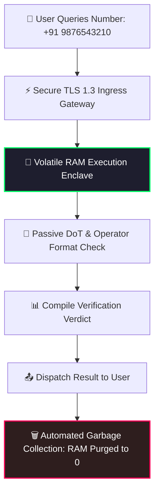

# 
🔒 PRIVACY POLICY & DATA GOVERNANCE DIRECTIVE

  

[-00FF66?style=for-the-badge&logo=shield&logoColor=black)](https://india.gov.in)
[-7928CA?style=for-the-badge&logo=ram&logoColor=white)](./PRIVACY_POLICY.md#3-categories-of-data-processed)

[_IT_Rules-FF9933?style=for-the-badge&logo=telegram&logoColor=white)](./PRIVACY_POLICY.md#10-grievance-redressal-officer)

---

[Home](./README.md) • [Terms of Service](./TERMS_OF_SERVICE.md) • [Legal Disclaimer](./LEGAL_DISCLAIMER.md) • [Acceptable Use](./ACCEPTABLE_USE_POLICY.md) • [Telecom Compliance](./COMPLIANCE_AND_TELECOM.md) • [Security & IP](./SECURITY_AND_IP.md)

---

 

> [!NOTE]
> **Extreme Data Minimization Commitment:**  
> Fresh NumChecker does **NOT** store, archive, database, sell, or profile telephone numbers queried through the platform. Number checks execute inside transient server memory (RAM) and are permanently purged instantly upon transmission of the verification verdict.

---

## ⚡ Privacy Highlights (At a Glance)

| Privacy Principle | Our System Implementation | Legal Guarantee |
| :--- | :--- | :--- |
| **Phone Number Retention** | **0 Seconds (RAM-only)** — Discarded immediately after query. | DPDP Act 2023 Sec 6(1) |
| **User Data Collected** | Minimal Telegram User ID & anonymous payment receipts only. | IT Rules 2011 / DPDP Act |
| **Sensitive PII Stored** | **ZERO.** No Aadhaar, PAN, names, addresses, or GPS coordinates. | Sec 43A IT Act 2000 |
| **Third-Party Data Sale** | **STRICTLY FORBIDDEN.** We never sell data to brokers or advertisers. | Anti-Commercialization Policy |
| **Encryption Standard** | TLS 1.3 in-transit encryption across all gateways and microservices. | High-Grade Cryptography |
| **Redressal Mechanism** | Official In-Bot Ticket Desk (`/help` -> Privacy Desk) within 48h. | Rule 3(2) IT Rules 2021 |

---

## 🔄 Ephemeral Memory Processing Flow (Zero-Log Architecture)

---

## 📑 Table of Contents

1. [Introduction & Statement of Commitment](#1-introduction--statement-of-commitment)
2. [Statutory Alignment with DPDP Act, 2023](#2-statutory-alignment-with-the-dpdp-act-2023)
3. [Categories of Data Processed](#3-categories-of-data-processed)
4. [What We Do Not Collect (Sensitive PII)](#4-what-we-do-not-collect-sensitive-personal-data)
5. [Third-Party Disclosures & Non-Commercialization](#5-third-party-disclosures--non-commercialization)
6. [Data Security & Technical Safeguards](#6-data-security-and-technical-safeguards)
7. [User Rights under the DPDP Act, 2023](#7-user-rights-under-the-dpdp-act-2023)
8. [Children's Privacy Protection](#8-childrens-privacy)
9. [Amendments & Governance Updates](#9-changes-to-this-privacy-policy)
10. [Statutory Grievance Redressal Officer](#10-grievance-redressal-officer)

---

## 1. INTRODUCTION & STATEMENT OF COMMITMENT
Fresh NumChecker ("we", "us", or "our") is fundamentally committed to preserving the privacy, autonomy, and security of all individuals and organizations interacting with our platform. 

This Privacy Policy explains how our systems process telecommunication parameters and operational data when you interact with our public documentation, Telegram bots, APIs, and client gateways.

We operate under an uncompromising philosophy of **Extreme Data Minimization** and **Zero-Log Ephemeral Processing**.

---

## 2. STATUTORY ALIGNMENT WITH THE DPDP ACT, 2023
This Policy conforms strictly to the mandate of the **Digital Personal Data Protection Act, 2023 (Act No. 22 of 2023, Republic of India)**, the **Information Technology Act, 2000**, and the **Information Technology (Reasonable Security Practices and Procedures and Sensitive Personal Data or Information) Rules, 2011**.

### Key Statutory Principles We Enforce:
1. **Lawfulness, Fairness, and Transparency:** We process data only for legitimate, defensive telecom hygiene and syntax verification purposes.
2. **Purpose Limitation:** Number verification requests are processed solely for the specific query submitted and for no other ancillary or secondary purpose.
3. **Data Minimization:** We collect, retain, and process the absolute minimum electronic telemetry required to return the query result.
4. **Storage Limitation:** Mobile telephone numbers submitted for checking are processed strictly in volatile Random Access Memory (RAM) and are permanently discarded immediately upon dispatch of the response payload.
5. **Integrity and Confidentiality:** Systems are architected with end-to-end cryptographic safeguards to prevent unauthorized interception.

---

## 3. CATEGORIES OF DATA PROCESSED

### 3.1. Mobile Phone Numbers (Ephemeral Processing Only)
- **What is processed:** The 10-digit Indian National Numbering Plan (NNP) mobile number entered by the user.
- **How it is processed:** The number is parsed in temporary server execution memory (volatile RAM) to evaluate carrier prefix, circle allocation, and account presence.
- **Retention Period:** **0 SECONDS.** The number is never written to disk, never logged in permanent database tables, never pooled into marketing databases, and never sold to third parties.

### 3.2. Operational Account Data (Telegram Platform)
When you interact with our official Telegram Bot:
- **Telegram User ID (Numerical):** Collected solely to identify your active session, track credit balances, and associate support tickets.
- **Username / First Name:** Displayed in your personal bot dashboard for user interface convenience.
- **Transaction Records:** If you purchase verification credits via UPI or automated payment gateways, our database maintains an anonymous ledger containing:
  - Internal Transaction Reference ID;
  - Amount paid and credits credited;
  - Timestamp of confirmation.
- **What we NEVER collect:** We never collect, process, or store bank account passwords, UPI PINs, credit card CVVs, or sensitive financial authentication credentials.

### 3.3. Technical Telemetry & Server Logs
To ensure infrastructure stability and defend against DDoS attacks, our cloud gateways may collect temporary system logs:
- Anonymized Client IP addresses (hashed);
- Request timestamps and rate-limit counters;
- API response latency metrics (milliseconds).
These logs are aggregated for infrastructure health audits and automatically rotated and purged every 7 (seven) days.

---

## 4. WHAT WE DO NOT COLLECT (SENSITIVE PERSONAL DATA)
Fresh NumChecker specifically **DOES NOT** collect, process, demand, or maintain:
- Names, physical residential addresses, or postal codes of telephone number subscribers;
- Government identification identifiers (Aadhaar, PAN, Voter ID, Passport);
- Biometric data or facial geometry;
- SMS payload contents, call records (CDR), or private message histories;
- Device GPS location coordinates;
- Contact books or address book dumps.

---

## 5. THIRD-PARTY DISCLOSURES & NON-COMMERCIALIZATION
5.1. **Zero Data Brokering.** We do not sell, rent, lease, syndicate, license, or barter any personal data, telemetry, or telephone numbers to data brokers, ad networks, insurance agencies, or telemarketing aggregators.  
5.2. **Service Providers.** We utilize reputable enterprise infrastructure providers (such as cloud virtual private servers and Telegram API infrastructure) strictly as technical data processors bound by industry-standard confidentiality obligations.  
5.3. **Lawful Disclosures.** We will disclose operational telemetry only if strictly compelled by a lawful, valid order issued by a competent court of law or authorized Indian statutory investigative agency under the provisions of the **Code of Criminal Procedure, 1973 / Section 94 of Bharatiya Nagarik Suraksha Sanhita, 2023** or **Section 69 of the Information Technology Act, 2000**.

---

## 6. DATA SECURITY AND TECHNICAL SAFEGUARDS
We maintain state-of-the-art technological and organizational measures to protect data from unauthorized access, alteration, or destruction:
- **Transport Layer Security (TLS 1.3):** All external and internal transmissions are encrypted using military-grade TLS 1.3 encryption suites.
- **Ephemeral RAM Execution:** The core verification engine executes in memory-isolated enclaves where data resides only for the lifespan of the request pipeline.
- **Automated Memory Flushing:** Automated memory garbage collection cycles run continuously to prevent residue retention in swap partitions.
- **Strict Network Isolation:** Backend core engines communicate through isolated virtual private clouds with zero direct public ingress.

---

## 7. USER RIGHTS UNDER THE DPDP ACT, 2023

As a Data Principal under the Digital Personal Data Protection Act, 2023, you enjoy statutory rights:

<table>
  <tr>
    <td width="50%">
      <b>1. Right to Access Information</b> 
      Request an overview of all account identifiers and transactional balances linked to your active Telegram ID.
    </td>
    <td width="50%">
      <b>2. Right to Correction & Erasure</b> 
      Request the immediate, permanent deletion of your Telegram ID and wallet history from our active ledger.
    </td>
  </tr>
  <tr>
    <td width="50%">
      <b>3. Right to Grievance Redressal</b> 
      Access rapid grievance redressal through our designated officer within statutory deadlines (48h acknowledgment).
    </td>
    <td width="50%">
      <b>4. Right to Nominate</b> 
      Nominate an authorized representative to exercise data rights in the event of death or incapacity.
    </td>
  </tr>
</table>

To exercise any of these statutory rights, submit an official request through our bot ticket interface using the <kbd>/help</kbd> command.

---

## 8. CHILDREN'S PRIVACY
Our platform is strictly intended for use by adults, system administrators, and verified professionals. We do not knowingly solicit or collect data from persons under the age of 18 (eighteen). If we discover that an individual under the age of majority has accessed the service, their account records will be terminated immediately.

---

## 9. CHANGES TO THIS PRIVACY POLICY
We reserve the right to revise, modernize, or amend this Privacy Policy to reflect evolving regulatory directives or infrastructural changes. Any updates will be pushed directly to this public repository with an updated effective date. Your continued interaction with the platform following any update constitutes acceptance of the amended terms.

---

## 10. GRIEVANCE REDRESSAL OFFICER
In accordance with Rule 3(2) of the Information Technology Rules, 2021 and Section 13 of the DPDP Act, 2023, you may contact our designated Privacy and Grievance Desk:

- **Entity:** Fresh NumChecker Data Protection & Compliance Directorate
- **Electronic Redressal Mechanism:** Telegram Bot Helpdesk (`/help` -> Privacy Grievance Ticket)
- **Response Protocol:** Formal acknowledgment within 48 hours; substantive resolution within 15 business days.

 

<a href="#top">⬆ Back to Top</a>

  

**© 2026 Fresh NumChecker Inc. All Rights Reserved.**  
*Fully Compliant with the Digital Personal Data Protection Act, 2023 (Republic of India).*

