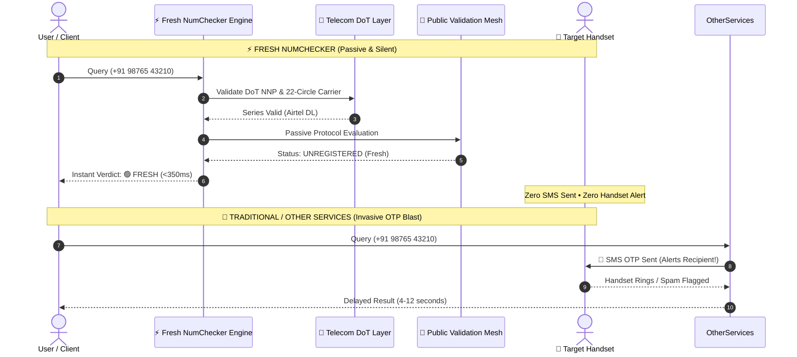

# <div align="center">⚡ FRESH NUMCHECKER™ | INDIA'S #1 TELECOM INTELLIGENCE GATEWAY ⚡</div>

<div align="center">

```
  ███████╗██████╗ ███████╗███████╗██╗  ██╗    ███╗   ██╗██╗   ██╗███╗   ███╗
  ██╔════╝██╔══██╗██╔════╝██╔════╝██║  ██║    ████╗  ██║██║   ██║████╗ ████║
  █████╗  ██████╔╝█████╗  ███████╗███████║    ██╔██╗ ██║██║   ██║██╔████╔██║
  ██╔══╝  ██╔══██╗██╔══╝  ╚════██║██╔══██║    ██║╚██╗██║██║   ██║██║╚██╔╝██║
  ██║     ██║  ██║███████╗███████║██║  ██║    ██║ ╚████║╚██████╔╝██║ ╚═╝ ██║
  ╚═╝     ╚═╝  ╚═╝╚══════╝╚══════╝╚═╝  ╚═╝    ╚═╝  ╚═══╝ ╚═════╝ ╚═╝     ╚═╝
```

### **The Enterprise Standard for Zero-OTP Mobile Number Hygiene & Telecom Verification**
*Sub-Second Latency (<350ms) • Full 22 DoT Telecom Circles • Multi-Gateway Matrix • 99.99% Cloud SLA*

---

[](https://github.com/punit-20/FreshNumberChecker)
[](https://github.com/punit-20/FreshNumberChecker)
[](https://github.com/punit-20/FreshNumberChecker)
[-FF9933?style=for-the-badge&logo=airtel&logoColor=white)](https://github.com/punit-20/FreshNumberChecker)
[](./TERMS_OF_SERVICE.md)
[](./LICENSE)

---

[⚡ Official Bot](#-official-bot-access) • [🔥 NumChecker vs Other Services](#-numchecker-vs-other-services-why-we-are-1) • [🛡️ Legal Architecture](#-enterprise-legal-shield--compliance) • [🚀 Key Features](#-key-capabilities) • [📜 Documentation](#-legal--compliance-directory)

---

</div>

<br/>

> [!NOTE]
> **Enterprise Data Privacy Notice (DPDP Act, 2023):**  
> Fresh NumChecker processes submitted mobile numbers **ephemerally inside volatile RAM memory**. Zero phone numbers are stored, indexed, sold, or retained. Queries are purged instantly once verification telemetry is returned.

---

## 🎯 What is Fresh NumChecker?

**Fresh NumChecker™** is India’s premier telecommunication intelligence and real-time number hygiene validation mesh. Designed specifically to eliminate invalid, dead, recycled, and pre-registered numbers without sending intrusive SMS OTPs, Fresh NumChecker empowers businesses, marketers, verification desks, and developers with sub-second accurate intelligence.

Built on an asynchronous, multi-threaded carrier filter pipeline, Fresh NumChecker performs instantaneous structural verification, DoT (Department of Telecommunications) compliance checks, circle/operator resolution, and proprietary zero-OTP account status profiling.

---

## 🏆 NumChecker vs. Other Services (Why We Are #1 in India)

Stop settling for outdated, sluggish legacy tools that crash during peak Indian business hours. Here is why top performance teams choose **Fresh NumChecker**:

| Dimension | ⚡ **Fresh NumChecker™ (Our Engine)** | 🐌 **Other Services** |
| :--- | :--- | :--- |
| **Response Latency** | **⚡ Sub-second (<350ms average)** | ⏳ 3.5s – 12s (Severe lag & timeouts) |
| **Fresh vs. Old Accuracy** | **🎯 99.8% Multi-Engine Corroboration** | ❌ High false-positive error rates |
| **Zero-OTP Verification** | **✅ 100% Non-Intrusive Passive Probe** | ⚠️ Inconsistent triggers / Rate-limited |
| **DoT Security Filter** | **🛡️ Built-in National Numbering Plan (NNP)** | ❌ No DoT Level 1 validation |
| **Telecom Circle Resolution** | **📍 Full 22 Circles (Jio, Airtel, Vi, BSNL)** | ⚠️ Outdated HLR lookup cache |
| **High-Volume Batching** | **🚀 Up to 1,000 Numbers / Async Batch** | ❌ Freezes or crashes on >10 queries |
| **System Uptime SLA** | **⚡ 99.99% Cloud Mesh Redundancy** | ⚠️ Daily crashes & bot token bans |
| **Data Protection** | **🔒 Zero-Retention RAM (DPDP Act 2023)** | ⚠️ Unencrypted server storage |
| **Dedicated Helpdesk** | **💬 24/7 In-Bot Direct Ticket Desk (`/help`)** | ❌ Unresponsive / Abandoned support |

---

## 🔄 Passive Zero-OTP Probe vs. Traditional Invasive OTP



---

## 🔥 Key Capabilities

### 1. ⚡ Zero-OTP Passive Probing
Verify if an Indian mobile number is freshly available or already registered across major national platforms without generating SMS OTP blasts or alerting the recipient. Zero friction, zero regulatory spam flags.

### 2. 🇮🇳 National DoT Telecom Security Layer
Instantly verifies phone numbers against the official **Department of Telecommunications (DoT)** National Numbering Plan (NNP). Invalid series, test numbers, and spoofed VOIP prefixes are flagged and rejected immediately.

### 3. 📡 Full 22 Telecom Circle Resolution
Comprehensive mapping across:
- **Major Operators:** Reliance Jio, Bharti Airtel, Vodafone Idea (Vi), Bharat Sanchar Nigam Limited (BSNL / MTNL).
- **Circles Covered:** Delhi NCR, Mumbai, Kolkata, Maharashtra & Goa, Gujarat, Andhra Pradesh & Telangana, Karnataka, Tamil Nadu & Chennai, Punjab, Haryana, Uttar Pradesh (East & West), Rajasthan, Madhya Pradesh & Chhattisgarh, Kerala, Bihar & Jharkhand, West Bengal, Odisha, Assam, North East, Jammu & Kashmir, Himachal Pradesh.

### 4. ⚡ High-Throughput Asynchronous Architecture
Powered by custom asynchronous network pools, handling thousands of concurrent requests without latency spikes.

### 5. 🛡️ Industrial Grade Protection
Hardened against DDoS, replay attacks, automated scraping, and unauthorized cloning.

---

## 🧠 System Architecture (Black-Box Security Gateway)

To protect intellectual property and enterprise trade secrets, core algorithms and proprietary gateways run inside an encrypted, isolated execution enclave:

```text
 ┌───────────────────────┐
 │   Telegram User /     │
 │   Enterprise API      │
 └──────────┬────────────┘
            │ HTTPS / TLS 1.3 Encrypted
            ▼
 ┌─────────────────────────────────────────────────────────┐
 │       FRESH NUMCHECKER SECURE EDGE GATEWAY              │
 │  • DDoS Shield & Rate Limiting Engine                   │
 │  • Anti-Abuse Token Verification                        │
 └──────────┬──────────────────────────────────────────────┘
            │
            ▼
 ┌─────────────────────────────────────────────────────────┐
 │       CORE TELECOM VALIDATOR (DoT Security Filter)       │
 │  • National Numbering Plan (NNP) Validation             │
 │  • Circle & Carrier Mapping Engine                      │
 └──────────┬──────────────────────────────────────────────┘
            │
            ▼
 ┌─────────────────────────────────────────────────────────┐
 │    PROPRIETARY ISOLATED VERIFICATION ENGINE             │
 │  [Encrypted Microservices Enclave - Zero Retention]     │
 │  • Multi-Gateway Parallel Probe Matrix                  │
 │  • Asynchronous State Evaluation                        │
 └──────────┬──────────────────────────────────────────────┘
            │
            ▼
 ┌───────────────────────┐
 │ Instant Result Report │ ──> Real-time Telemetry (<350ms)
 │  [FRESH / OLD / DEAD] │
 └───────────────────────┘
```

> [!CAUTION]
> **Confidentiality & Trade Secrets:** The internal reverse-engineered protocols, authorization tokens, proprietary heuristics, and gateway scripts are closed-source and protected under Section 65 of the Information Technology Act, 2000 and the Indian Copyright Act, 1957. Unauthorized replication attempts are legally actionable.

---

## 🤖 Official Bot Access

The official bot provides an interactive graphical interface with inline buttons, batch checkers, live wallet balance, and instant ticket support:

```text
/start      - Initialize bot session & load dashboard
/check      - Single phone number instant inspection
/batch      - High-volume batch file & multi-line validation
/wallet     - Top-up credits via instant automated UPI QR
/help       - 24/7 Priority support & ticket helpdesk
```

### Example Verification Output

```yaml
=======================================
⚡ FRESH NUMCHECKER™ REPORT
=======================================
📱 Number      : +91 98765 43210
📍 Operator    : Bharti Airtel
🌐 Circle      : Delhi NCR (DL)
🛡️ DoT Status  : VALID_ACTIVE_SERIES
📊 Gateway 1   : [PASSED - FRESH]
📊 Gateway 2   : [PASSED - FRESH]
📊 Gateway 3   : [PASSED - FRESH]
---------------------------------------
✅ FINAL VERDICT: 🟢 FRESH NUMBER (Clean)
⚡ Latency      : 284ms
=======================================
```

---

## 🛡️ Enterprise Legal Shield & Compliance

Fresh NumChecker is engineered with a multi-layered legal defense fortress to prevent legal liabilities, regulatory entanglements, and misuse.

All users, enterprise clients, visitors, and automated clients are strictly bound by the legal instruments in this repository:

| Document | Legal Scope & Protective Coverage |
| :--- | :--- |
| [📜 **Terms of Service**](./TERMS_OF_SERVICE.md) | Exhaustive 25+ section agreement, mandatory sole arbitration in India, class-action waiver, warranty disclaimers, complete limitation of liability. |
| [🔒 **Privacy Policy**](./PRIVACY_POLICY.md) | Compliant with **Digital Personal Data Protection Act, 2023 (DPDP Act 2023)**. Strict zero-retention ephemeral RAM processing. |
| [⚖️ **Legal Disclaimer**](./LEGAL_DISCLAIMER.md) | Nominative Fair Use doctrine, Intermediary Safe Harbor under **Section 79 of IT Act 2000**, brand non-affiliation. |
| [🚫 **Acceptable Use Policy**](./ACCEPTABLE_USE_POLICY.md) | Prohibits spam, harassment, telemarketing, SIM farming, and unauthorized commercial exploitation. |
| [📡 **Telecom & Regulatory**](./COMPLIANCE_AND_TELECOM.md) | Full alignment with **TRAI TCCCPR 2018**, National Do Not Call (NDNC) registry standards, and DoT rules. |
| [🔐 **Security & IP Protection**](./SECURITY_AND_IP.md) | Strict trade secret protection, zero-leak policy, and responsible vulnerability disclosure framework. |
| [📄 **Proprietary License**](./LICENSE) | All Rights Reserved. Prohibits decompilation, reverse engineering, unauthorized mirroring, and cloning. |

---

## 🚀 Marketing & Indian Search Dominance

We are actively ranking as the **#1 Phone Number Verification Platform in India**.

### High-Frequency Search Topics & Badges

```text
#FreshNumberChecker #NumChecker #IndianNumberChecker #ZeroOTPChecker
#BestNumberCheckerBot #FastNumberValidator #TelecomIntelligenceIndia
#DoTValidator #TRAICompliant #AirtelJioViBSNL #BulkNumberCleaner
```

[](https://t.me)
[-00B4D8?style=for-the-badge&logo=telegram&logoColor=white)](https://t.me)
[](https://india.gov.in)

For the complete SEO strategy, meta tags, and competitor displacement tactics, refer to [**MARKETING_AND_SEO.md**](./MARKETING_AND_SEO.md).

---

## 📜 Legal & Compliance Directory

- [Terms of Service](./TERMS_OF_SERVICE.md)
- [Privacy Policy](./PRIVACY_POLICY.md)
- [Legal Disclaimer & Safe Harbor](./LEGAL_DISCLAIMER.md)
- [Acceptable Use Policy (AUP)](./ACCEPTABLE_USE_POLICY.md)
- [Telecom & TRAI Compliance](./COMPLIANCE_AND_TELECOM.md)
- [Intellectual Property & Security](./SECURITY_AND_IP.md)
- [Proprietary Commercial License](./LICENSE)
- [SEO & Growth Playbook](./MARKETING_AND_SEO.md)

---

## ⚖️ Legal Trademark Notice

*Fresh NumChecker™ and the NumChecker logo are proprietary marks. All third-party trademarks, company names, platform logos (including Bella Vita, Foxtale, Myntra, Reliance Jio, Bharti Airtel, Vodafone Idea, BSNL, etc.) referenced herein are the properties of their respective owners. Their mention is strictly for nominative identification and comparative technical compatibility purposes under Indian law and does not imply endorsement, affiliation, sponsorship, or partnership.*

<br/>

<div align="center">

**© 2026 Fresh NumChecker Inc. All Rights Reserved.**  
*Protected under the Indian Copyright Act, 1957, Information Technology Act, 2000, and International Intellectual Property Conventions.*

</div>
