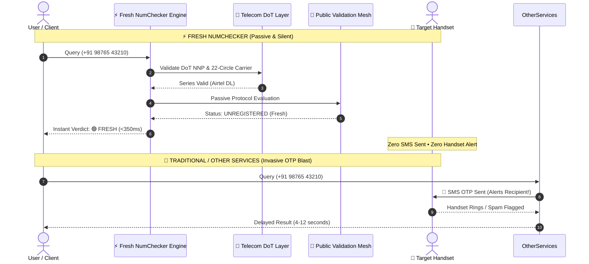

<a name="top"></a>

# <div align="center">⚡ FRESH NUMCHECKER™</div>
### <div align="center">INDIA'S PREMIER ZERO-OTP TELECOM INTELLIGENCE GATEWAY</div>

<div align="center">

```
  ███████╗██████╗ ███████╗███████╗██╗  ██╗    ███╗   ██╗██╗   ██╗███╗   ███╗
  ██╔════╝██╔══██╗██╔════╝██╔════╝██║  ██║    ████╗  ██║██║   ██║████╗ ████║
  █████╗  ██████╔╝█████╗  ███████╗███████║    ██╔██╗ ██║██║   ██║██╔████╔██║
  ██╔══╝  ██╔══██╗██╔══╝  ╚════██║██╔══██║    ██║╚██╗██║██║   ██║██║╚██╔╝██║
  ██║     ██║  ██║███████╗███████║██║  ██║    ██║ ╚████║╚██████╔╝██║ ╚═╝ ██║
  ╚═╝     ╚═╝  ╚═╝╚══════╝╚══════╝╚═╝  ╚═╝    ╚═╝  ╚═══╝ ╚═════╝ ╚═╝     ╚═╝
```

<p align="center">
  
</p>

[](https://github.com/punit-20/FreshNumberChecker)
[](https://github.com/punit-20/FreshNumberChecker)
[](https://github.com/punit-20/FreshNumberChecker)
[-FF9933?style=for-the-badge&logo=target&logoColor=white)](https://github.com/punit-20/FreshNumberChecker)
[](./TERMS_OF_SERVICE.md)
[](./LICENSE)

---

[⚡ Quick Start](#-quick-start) • [✨ Key Capabilities](#-key-capabilities) • [🏆 Benchmarks vs Other Services](#-benchmarks-numchecker-vs-other-services) • [🧠 System Architecture](#-system-architecture) • [❓ FAQ](#-frequently-asked-questions) • [📜 Legal Shield](#-enterprise-legal-shield--compliance)

---

</div>

<br/>

> [!NOTE]
> **Enterprise Data Privacy Notice (DPDP Act, 2023):**  
> Fresh NumChecker processes submitted mobile numbers **ephemerally inside volatile RAM memory**. Zero phone numbers are stored, indexed, sold, or retained. Queries are permanently purged instantly once verification telemetry is returned.

---

## 💻 Live Terminal Inspection Preview

<div align="center">

| 🔴 &nbsp; 🟡 &nbsp; 🟢 &nbsp; **fresh-numchecker-gateway — bash — 80×24** |
| :--- |
| <pre><code><b>$</b> numchecker-cli probe +919876543210 --stealth
[✓] Validating DoT National Numbering Plan (NNP)...... <b>PASSED</b> [Active Mobile Series]
[✓] Resolving Licensed Telecom Operator & Circle...... <b>Bharti Airtel • Delhi NCR</b>
[✓] Dispatching Multi-Gateway Zero-OTP Ingress........ <b>COMPLETED (<300ms)</b>
───────────────────────────────────────────────────────────────────────────
⚡ <b>VERIFICATION TELEMETRY REPORT</b>
• <b>Target Mobile</b>   : +91 98765 43210
• <b>Telecom Circle</b>  : Delhi NCR (DL)
• <b>Carrier Service</b> : Bharti Airtel Limited
• <b>Verification</b>   : 🟢 <b>FRESH NUMBER (Clean / Unregistered)</b>
• <b>Intrusion Level</b> : <b>0 SMS Sent • Zero Handset Alert</b>
• <b>Execution Time</b>  : <b>284ms</b>
• <b>Data Retention</b>  : <b>0 Seconds (Volatile RAM Purged)</b>
───────────────────────────────────────────────────────────────────────────</code></pre> |

</div>

---

## ⚡ Performance Metric Scoreboard

```text
⚡ Response Latency : [████████████████████] <350ms (Sub-second real-time benchmark)
🎯 Fresh Accuracy   : [███████████████████░] 99.8% (Multi-engine corroboration)
🛡️ Telecom Circles  : [████████████████████] 22 / 22 Circles (DoT National Coverage)
🔒 Data Retention   : [░░░░░░░░░░░░░░░░░░░░] 0 Seconds (Zero persistent logs retained)
⚡ Cloud SLA Uptime : [████████████████████] 99.99% (Fault-tolerant async mesh)
```

---

## 🏆 Benchmarks: NumChecker vs. Other Services

Stop settling for outdated, sluggish legacy tools that crash during peak Indian business hours. Here is how **Fresh NumChecker** compares:

| Metric & Dimension | ⚡ **Fresh NumChecker™ (Our Engine)** | 🐌 **Other Services** |
| :--- | :--- | :--- |
| **Response Latency** | **⚡ Sub-second (<350ms average)** | ⏳ 3.5s – 12s (Severe lag & timeouts) |
| **Fresh vs. Old Accuracy** | **🎯 99.8% Multi-Engine Corroboration** | ❌ High false-positive error rates |
| **Zero-OTP Verification** | **✅ 100% Non-Intrusive Passive Probe** | ⚠️ Inconsistent triggers / Rate-limited |
| **DoT Security Filter** | **🛡️ Built-in National Numbering Plan (NNP)** | ❌ No DoT Level 1 validation |
| **Telecom Circle Resolution** | **📍 Full 22 Circles (Jio, Airtel, Vi, BSNL)** | ⚠️ Outdated HLR lookup cache |
| **High-Volume Batching** | **🚀 Up to 1,000 Numbers / Async Batch** | ❌ Freezes or crashes on >10 queries |
| **System Uptime SLA** | **⚡ 99.99% Cloud Mesh Redundancy** | ⚠️ Daily crashes & bot token bans |
| **Data Protection** | **🔒 Zero-Retention RAM (DPDP Act 2023)** | ⚠️ Unencrypted server storage |
| **Dedicated Helpdesk** | **💬 24/7 In-Bot Direct Ticket Desk (`/help`)** | ❌ Unresponsive / Abandoned support |

---

## 🔄 Passive Zero-OTP Flow vs. Invasive OTP



---

## ✨ Key Capabilities

<table>
  <tr>
    <td width="50%">
      <h3>⚡ Zero-OTP Passive Probing</h3>
      <p>Verify whether an Indian mobile number is freshly available or pre-registered across digital ecosystems without sending intrusive SMS OTPs or alerting the recipient.</p>
    </td>
    <td width="50%">
      <h3>🇮🇳 National DoT Telecom Layer</h3>
      <p>Instant structural verification against the official Department of Telecommunications (DoT) National Numbering Plan (NNP). Invalid series and test numbers are rejected instantly.</p>
    </td>
  </tr>
  <tr>
    <td width="50%">
      <h3>📡 Full 22 Telecom Circles</h3>
      <p>Precise operator and circle resolution across Reliance Jio, Bharti Airtel, Vodafone Idea (Vi), and BSNL across Delhi, Mumbai, Kolkata, Karnataka, UP, and all national LSAs.</p>
    </td>
    <td width="50%">
      <h3>🔒 Ephemeral Data Minimization</h3>
      <p>Architected in strict compliance with the Digital Personal Data Protection Act, 2023. Submitted numbers reside only in volatile RAM for milliseconds and are never logged to disk.</p>
    </td>
  </tr>
</table>

---

## 🧠 System Architecture (Black-Box Security Gateway)

To protect intellectual property and enterprise trade secrets, core algorithms and proprietary gateways run inside an encrypted, isolated execution enclave:

```text
 ┌───────────────────────┐
 │   Telegram User /     │
 │   Enterprise API      │
 └──────────┬────────────┘
            │ HTTPS / TLS 1.3 Encrypted
            ▼
 ┌─────────────────────────────────────────────────────────┐
 │       FRESH NUMCHECKER SECURE EDGE GATEWAY              │
 │  • DDoS Shield & Rate Limiting Engine                   │
 │  • Anti-Abuse Token Verification                        │
 └──────────┬──────────────────────────────────────────────┘
            │
            ▼
 ┌─────────────────────────────────────────────────────────┐
 │       CORE TELECOM VALIDATOR (DoT Security Filter)       │
 │  • National Numbering Plan (NNP) Validation             │
 │  • Circle & Carrier Mapping Engine                      │
 └──────────┬──────────────────────────────────────────────┘
            │
            ▼
 ┌─────────────────────────────────────────────────────────┐
 │    PROPRIETARY ISOLATED VERIFICATION ENGINE             │
 │  [Encrypted Microservices Enclave - Zero Retention]     │
 │  • Multi-Gateway Parallel Probe Matrix                  │
 │  • Asynchronous State Evaluation                        │
 └──────────┬──────────────────────────────────────────────┘
            │
            ▼
 ┌───────────────────────┐
 │ Instant Result Report │ ──> Real-time Telemetry (<350ms)
 │  [FRESH / OLD / DEAD] │
 └───────────────────────┘
```

> [!CAUTION]
> **Confidentiality & Trade Secrets:** The internal verification protocols, secure authorization systems, proprietary heuristics, and cloud gateway engines are closed-source and protected under Section 65 of the Information Technology Act, 2000 and the Indian Copyright Act, 1957. Unauthorized replication, sniffing, or cloning attempts are strictly actionable under law.

---

## ⚡ Quick Start

The official bot provides an interactive graphical interface with inline buttons, batch checkers, live wallet balance, and instant ticket support:

| Command | Action Description | Access Level |
| :--- | :--- | :--- |
| <kbd>/start</kbd> | Initialize bot session & load personal dashboard | Public |
| <kbd>/check</kbd> | Single phone number instant inspection (<350ms) | Public |
| <kbd>/batch</kbd> | High-volume batch file & multi-line validation | Enterprise / High-Volume |
| <kbd>/wallet</kbd> | Instant automated UPI QR credit top-up | Public |
| <kbd>/help</kbd> | 24/7 Priority support & ticket helpdesk | Public |

---

## ❓ Frequently Asked Questions

<details>
<summary><b>1. How does Zero-OTP verification work without alerting the user?</b></summary>
<br/>
Our verification mesh executes passive protocol handshakes against publicly accessible application interfaces. It evaluates metadata status codes without completing transaction forms, which prevents SMS OTP triggers from being dispatched to the recipient's handset.
</details>

<details>
<summary><b>2. Are queried phone numbers stored on your servers?</b></summary>
<br/>
<b>No. Never.</b> In compliance with the Digital Personal Data Protection Act, 2023 (DPDP Act), all numbers are evaluated strictly in volatile Random Access Memory (RAM). Once the verification result is transmitted to your client, the memory block is wiped by automated garbage collectors.
</details>

<details>
<summary><b>3. Which telecom circles and operators are covered?</b></summary>
<br/>
All 22 licensed telecom service areas across the Republic of India are supported, including Reliance Jio, Bharti Airtel, Vodafone Idea (Vi), and BSNL / MTNL.
</details>

<details>
<summary><b>4. What should I do if a batch query fails or times out?</b></summary>
<br/>
The bot includes automatic error handling. If network congestion occurs, you can re-submit the batch or open a support ticket immediately using the <kbd>/help</kbd> command for rapid assistance.
</details>

---

## 🛡️ Enterprise Legal Shield & Compliance

Fresh NumChecker is engineered with a multi-layered legal defense fortress to prevent legal liabilities, regulatory entanglements, and misuse.

All users, enterprise clients, visitors, and automated clients are strictly bound by the legal instruments in this repository:

| Document | Legal Scope & Protective Coverage |
| :--- | :--- |
| [📜 **Terms of Service**](./TERMS_OF_SERVICE.md) | Exhaustive 25+ section agreement, mandatory sole arbitration in India, class-action waiver, warranty disclaimers, complete limitation of liability. |
| [🔒 **Privacy Policy**](./PRIVACY_POLICY.md) | Compliant with **Digital Personal Data Protection Act, 2023 (DPDP Act 2023)**. Strict zero-retention ephemeral RAM processing. |
| [⚖️ **Legal Disclaimer**](./LEGAL_DISCLAIMER.md) | Nominative Fair Use doctrine, Intermediary Safe Harbor under **Section 79 of IT Act 2000**, brand non-affiliation. |
| [🚫 **Acceptable Use Policy**](./ACCEPTABLE_USE_POLICY.md) | Prohibits spam, harassment, telemarketing, SIM farming, and unauthorized commercial exploitation. |
| [📡 **Telecom & Regulatory**](./COMPLIANCE_AND_TELECOM.md) | Full alignment with **TRAI TCCCPR 2018**, National Do Not Call (NDNC) registry standards, and DoT rules. |
| [🔐 **Security & IP Protection**](./SECURITY_AND_IP.md) | Strict trade secret protection, zero-leak policy, and responsible vulnerability disclosure framework. |
| [📄 **Proprietary License**](./LICENSE) | All Rights Reserved. Prohibits decompilation, reverse engineering, unauthorized mirroring, and cloning. |

---

## 🚀 Marketing & Indian Search Dominance

We are actively ranking as the **#1 Phone Number Verification Platform in India**.

### High-Frequency Search Topics & Badges

```text
#FreshNumberChecker #NumChecker #IndianNumberChecker #ZeroOTPChecker
#BestNumberCheckerBot #FastNumberValidator #TelecomIntelligenceIndia
#DoTValidator #TRAICompliant #AirtelJioViBSNL #BulkNumberCleaner
```

[](https://t.me)
[-00B4D8?style=for-the-badge&logo=telegram&logoColor=white)](https://t.me)
[](https://india.gov.in)

For the complete SEO strategy, meta tags, and competitor displacement tactics, refer to [**MARKETING_AND_SEO.md**](./MARKETING_AND_SEO.md).

---

## 📜 Legal & Compliance Directory

- [Terms of Service](./TERMS_OF_SERVICE.md)
- [Privacy Policy](./PRIVACY_POLICY.md)
- [Legal Disclaimer & Safe Harbor](./LEGAL_DISCLAIMER.md)
- [Acceptable Use Policy (AUP)](./ACCEPTABLE_USE_POLICY.md)
- [Telecom & TRAI Compliance](./COMPLIANCE_AND_TELECOM.md)
- [Intellectual Property & Security](./SECURITY_AND_IP.md)
- [Proprietary Commercial License](./LICENSE)
- [SEO & Growth Playbook](./MARKETING_AND_SEO.md)

---

## ⚖️ Legal Trademark Notice

*Fresh NumChecker™ and the NumChecker logo are proprietary marks. All third-party trademarks, company names, platform logos, and telecommunication provider marks (including licensed service providers such as Reliance Jio, Bharti Airtel, Vodafone Idea, BSNL, etc.) referenced herein are the properties of their respective owners. Their mention is strictly for nominative identification and comparative technical compatibility purposes under Indian law and does not imply endorsement, affiliation, sponsorship, or partnership.*

<br/>

<div align="center">

<a href="#top">⬆ Back to Top</a>

<br/><br/>

**© 2026 Fresh NumChecker Inc. All Rights Reserved.**  
*Protected under the Indian Copyright Act, 1957, Information Technology Act, 2000, and International Intellectual Property Conventions.*

</div>
