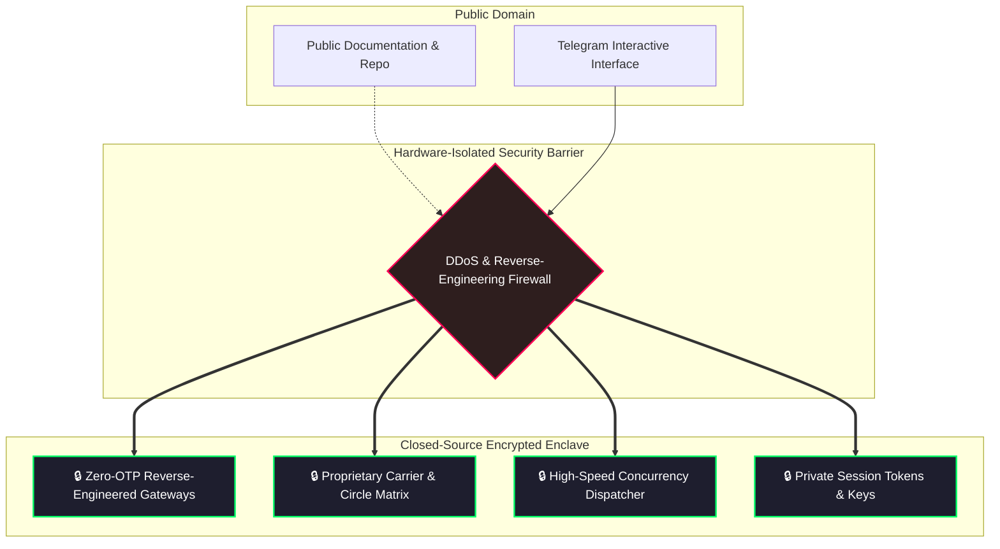

# 
🔐 INTELLECTUAL PROPERTY & SECURITY GOVERNANCE

---

[Home](./README.md) • [Terms of Service](./TERMS_OF_SERVICE.md) • [Privacy Policy](./PRIVACY_POLICY.md) • [Legal Disclaimer](./LEGAL_DISCLAIMER.md) • [Acceptable Use](./ACCEPTABLE_USE_POLICY.md) • [Telecom Compliance](./COMPLIANCE_AND_TELECOM.md)

---

 

> [!CAUTION]
> **CLOSED-SOURCE CONFIDENTIAL TRADE SECRET NOTICE:**  
> All underlying heuristics, reverse-engineered gateway protocols, token architectures, and database algorithms powering Fresh NumChecker are protected under the **Indian Copyright Act, 1957**, the **Information Technology Act, 2000**, and international trade secret conventions. Unauthorized decompilation, sniffing, mirroring, or cloning is strictly actionable under civil and criminal law.

---

## ⚡ Intellectual Property Governance (At a Glance)

| Proprietary Asset | Protection Framework | Enforcement Action |
| :--- | :--- | :--- |
| **Zero-OTP Heuristics** | Confidential Trade Secret (Common Law & Contract Act 1872) | DMCA Takedown & Criminal Injunction |
| **DoT Carrier Prefix Database** | Proprietary Database Right (Copyright Act 1957) | Civil Damages & Statutory Penalties |
| **Backend API Wrappers** | Closed-Source Intellectual Property | IT Act Section 43/66 Prosecution |
| **Branding & Layout** | Trademark & Trade Dress Rights | Cease & Desist / Asset Freezing Orders |
| **Responsible Disclosure** | Ethical Security Reporting via In-Bot Helpdesk (`/help`) | Recognition & Bounty Credits |

---

## 🛡️ Enclave Isolation & Trade Secret Defense

---

## 1. INTELLECTUAL PROPERTY & TRADE SECRETS DECLARATION
The architecture, operational methods, heuristics, bot workflows, zero-OTP reverse-engineered validation mechanisms, and backend orchestration logic powering **Fresh NumChecker** are the proprietary intellectual property and confidential trade secrets of the development team (the "Owners").

### 1.1. Proprietary Assets Covered:
- **Zero-OTP Account Detection Heuristics:** The mathematical algorithms and protocol workflows that ascertain number availability without transmitting SMS codes;
- **DoT Circle & Carrier Database Schemas:** The optimized internal relational matrices mapping Indian National Numbering Plan prefixes to licensed telecom operators;
- **Private API Gateways & Wrappers:** Custom connection pooling, concurrency dispatchers, and fault-tolerant retry handlers;
- **Session Tokens, API Keys & Cryptographic Secrets:** All internal authorization keys, session cookies, private headers, and server configurations;
- **User Interface, Commands, and Branding:** All custom command workflows, graphical layouts, interactive menus, and promotional marks.

---

## 2. STRICT NON-DISCLOSURE & ANTI-CLONING POLICY
To maintain competitive advantage, prevent malicious weaponization, and protect business integrity, **the core execution engine is closed-source and strictly confidential**.

### 2.1. Absolute Prohibition of Reverse Engineering
You may not:
- Attempt to decompile, disassemble, extract, debug, sniff, or inspect the backend binary or bytecode;
- Deploy network packet interceptors (e.g., Wireshark, Burp Suite, Fiddler, Charles Proxy) to capture private communication channels or reverse-engineer upstream provider endpoints;
- Replicate, clone, or create counterfeit bots or services that mimic the internal logic or presentation of Fresh NumChecker;
- Harvest, scrape, or publish our private API endpoints or tokens.

### 2.2. Legal Consequences of Infringement
Any attempt to copy, redistribute, clone, or steal the proprietary methods, tokens, or scripts of this project constitutes:
1. **Civil Copyright & Trade Secret Infringement** under the **Indian Copyright Act, 1957**, punishable by statutory injunctions, asset freezing, and punitive damages;
2. **Criminal Computer Hacking & Data Theft** under **Section 43 & Section 66 of the Information Technology Act, 2000**, punishable by imprisonment and substantial fines;
3. **Criminal Breach of Trust & Cheating** under the **Bharatiya Nyaya Sanhita, 2023**.

The Owners actively monitor GitHub, Telegram, dark web forums, and public code registries. Infringing repositories, mirrors, and accounts will be served with immediate **DMCA Takedown Notices**, statutory legal notices, and criminal complaints without prior warning.

---

## 3. RESPONSIBLE VULNERABILITY DISCLOSURE POLICY (VDP)
We welcome constructive security audits and responsible vulnerability disclosures from ethical security researchers.

### 3.1. Guidelines for Ethical Research:
- Conduct vulnerability testing exclusively against your own account or test numbers;
- Do not execute volumetric attacks (DDoS) or disrupt service availability for other users;
- Do not access, modify, or corrupt data belonging to other users;
- Provide a minimum of **90 (ninety) calendar days** for remediation before making any public disclosure.

### 3.2. Submitting a Security Finding:
If you identify a security vulnerability or critical flaw:
1. Open a private security ticket via the Telegram Bot dashboard (`/help` -> Security Report Desk);
2. Provide a detailed Proof of Concept (PoC) describing the issue, affected endpoints, and suggested remediation;
3. Acknowledge that you will not disclose the vulnerability publicly until an official patch has been deployed.

Qualifying security findings submitted in good faith may be eligible for recognition in our Security Hall of Fame and reward credits.

 

**© 2026 Fresh NumChecker Inc. All Rights Reserved.**  
*Closed-Source Proprietary Enclave • Protected Under Indian & International IP Laws.*

